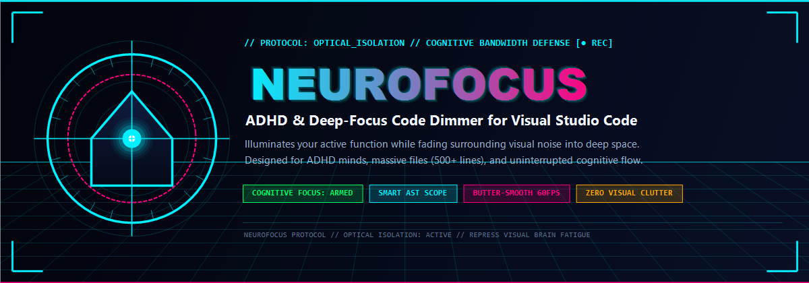
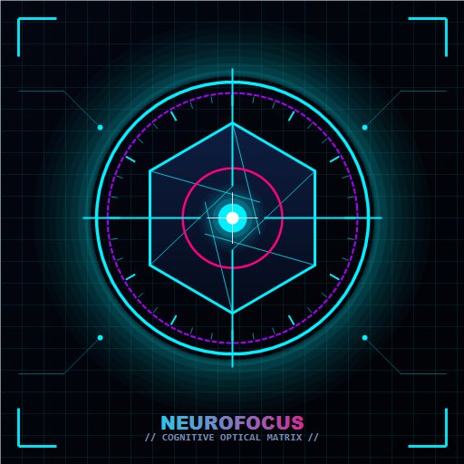

<div align="center">



<br/><br/>



# NEUROFOCUS
### `// CYBERNETIC DEEP FOCUS & ADHD CODE DIMMER FOR VS CODE //`

**Illuminates your active code function while fading surrounding visual noise into deep space.**

<br/>

[](https://github.com/gitwithmasum/NeuroFocus)
[](LICENSE)
[](https://github.com/gitwithmasum/NeuroFocus)
[](https://github.com/gitwithmasum/NeuroFocus)
[-ffaa00?style=for-the-badge)](https://github.com/gitwithmasum/NeuroFocus)

<br/>

---

</div>

## 🤯 The Problem: Cognitive Overload in Modern Codebases

Working in massive files (**300 to 1,000+ lines of code**) induces severe cognitive fatigue, especially for developers with **ADHD** or those in deep sprint sessions. When dozens of unrelated functions, imports, and variables constantly compete for your visual attention, your working memory fractures:

- **Loss of contextual flow** after scrolling or switching tabs.
- **Mental exhaustion** caused by scanning through walls of inactive code.
- **Micro-distractions** from peripheral syntax, comments, and variables.

**NeuroFocus** solves this by enforcing optical scope isolation. Wherever your cursor rests, NeuroFocus mathematically identifies the active function or block, leaves it brightly illuminated with an optional futuristic cyber-aura, and gently dims the surrounding file into the dark void.

---

## ⚡ Futuristic Capabilities

```
╔═══════════════════════════════════════════════════════════════════════════════╗
║  [TELEMETRY] NEUROFOCUS COGNITIVE SENTINEL MATRIX                             ║
╠═══════════════════════════════════════════════════════════════════════════════╣
║  • Smart AST Scope Engine : Automatically calculates enclosing function/block  ║
║  • Multi-Stage Dimmer     : 5% to 75% configurable opacity for perimeter code ║
║  • Cyber Focus Aura       : Subtle neon cyan/violet beam on active scope      ║
║  • Zero Lag Architecture  : 35ms debounced 60fps tracking (no typing delay)   ║
║  • 3 Agile Focus Modes    : Function Mode, Bracket Block Mode, Radius Mode    ║
║  • 1-Click Instant Toggle : 'Alt + N' hotkey & responsive Status Bar widget   ║
╚═══════════════════════════════════════════════════════════════════════════════╝
```

### 1. 🧠 Smart AST & Symbol Scoping
NeuroFocus queries language servers and symbol hierarchies to find the true scope of your current `function`, `method`, `class`, or `async def`. Move your cursor to another function, and the spotlight glides with you.

### 2. 🌑 Multi-Stage Deep Dimmer
Control exactly how dark your surroundings become. Choose anywhere between **0.05 (near total black-out)** to **0.50 (subtle contrast)**. Default is set to a crisp, calming **0.25 (75% dimmed)**.

### 3. 🛸 Cyberpunk Focus Aura
Enjoy a high-tech developer aesthetic. The illuminated block receives an elegant neon indicator line down the gutter (choose from `Cyan`, `Magenta`, `Violet`, `Matrix Green`, or `Minimal`).

### 4. 🎯 3 Adaptive Focus Modes
- **`Function Mode` (Default):** Highlights the entire active function from declaration to closing return.
- **`Block Mode`:** Isolates the immediate `{ ... }` block, `if/else`, or `loop`.
- **`Radius Mode`:** Keeps a clean Gaussian halo of lines above and below your cursor (ideal for Markdown, plain text, and flat scripts).

---

## ⌨️ Keyboard Shortcuts

| Shortcut | Command | Action |
| :--- | :--- | :--- |
| **`Alt + N`** | `neurofocus.toggle` | Toggle Deep Focus Dimmer on/off |
| **`Alt + Shift + N`** | `neurofocus.cycleMode` | Switch between Function $\rightarrow$ Block $\rightarrow$ Radius mode |
| *Command Palette* | `neurofocus.increaseDimming` | Darken background code (lower opacity) |
| *Command Palette* | `neurofocus.decreaseDimming` | Brighten background code (increase opacity) |

---

## ⚙️ Configuration

Customize NeuroFocus via VS Code Settings (`Ctrl + ,` -> search `NeuroFocus`):

```json
{
  // Activate or stand down NeuroFocus
  "neurofocus.enabled": true,

  // Opacity of dimmed background code (0.05 to 0.75, default: 0.25)
  "neurofocus.opacity": 0.25,

  // Focus algorithm: "function", "block", or "radius"
  "neurofocus.focusMode": "function",

  // Lines above and below cursor for Radius Mode
  "neurofocus.radiusLines": 6,

  // Display futuristic cyber-aura border along active scope
  "neurofocus.enableActiveGlow": true,

  // Aura color theme: "cyan", "magenta", "violet", "matrixGreen", "minimal"
  "neurofocus.glowColor": "cyan",

  // Languages to automatically exempt from dimming
  "neurofocus.excludedLanguages": [
    "markdown",
    "plaintext"
  ]
}
```

---

## 🛠️ Building & Contributing Locally

```bash
# 1. Clone the repository
git clone https://github.com/gitwithmasum/NeuroFocus.git
cd NeuroFocus

# 2. Install dependencies
npm install

# 3. Build optimized bundle
npm run build

# 4. Run unit test suite
npm test
```

Press **`F5`** inside VS Code to launch the **Extension Development Host** and test in real-time.

---

<div align="center">
  <sub>Engineered for deep work. Protect your cognitive bandwidth.</sub>
</div>
